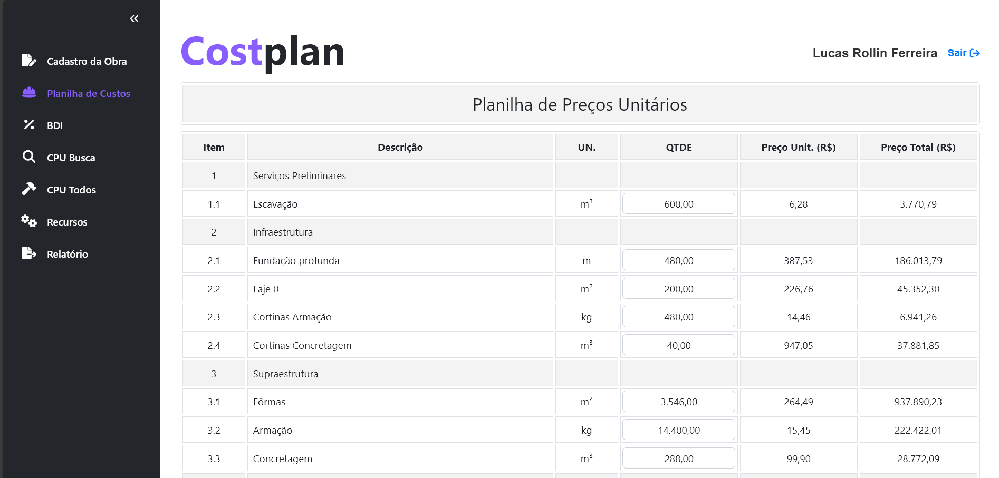

# Costplan Core: Civil Construction Budgeting Web App

Costplan is a web application for budgeting civil engineering projects. Create a project and it automatically generates a Cost Breakdown Sheet (CBS) pre-filled with standard activities, so you only adjust quantities.

**Stack:** Django · SQLite · Vanilla JavaScript (SPA) · Sass · Bootstrap



## Overview

Unlike generic budgeting tools, Costplan specializes in one project type. Standard activities and their resource requirements (Cost Compositions) are defined once and reused across projects, which removes most manual data entry and keeps estimates consistent.

**Key terms**

| Term | Meaning |
|------|---------|
| **CBS** (Cost Breakdown Sheet) | Hierarchical list of project activities with quantities and costs |
| **Cost Composition** | The resources (materials, labor, equipment) needed per unit of a CBS item |
| **BDI** (Budget Difference Income) | Markup applied to direct costs to cover taxes, indirect costs and profit |
| **Resource** | A priced input: material, labor or service |

## Features

- **Project creation:** Name projects and store detailed information.
- **Automatic CBS generation:** Standard activities are created with the project; users only enter quantities.
- **Reusable Cost Compositions:** Define resource requirements for CBS items once and reuse them across projects.
- **Cost Breakdown Templates:** Adjust quantities for different contexts (e.g., regional variations).
- **BDI table:** Apply taxes and profit margins through a dedicated table.
- **Resource models:** Store market prices for materials, labor and services.
- **Admin page:** Manage all models, including resource prices.
- **Single Page Application:** Dynamic, real-time updates and navigation via AJAX.
- **Mobile responsive:** The sidebar becomes a bottom navbar on small screens.
- **PDF export:** Print-ready CBS and project reports, with no external PDF libraries.

## Design Highlights

**Back end**
- 10 Django models with hierarchical relationships representing real engineering data (CBS trees, resource hierarchies, per-project BDI rates).
- Project setup is automated: creating a project generates its cost breakdown and BDI rows from the standard template.
- A JSON API serves the SPA, with pagination where needed.

**Front end**
- Hash-based SPA routing in vanilla JavaScript, with lazy-loaded page modules.
- Real-time total and subtotal calculations as users type.
- PDF reports built from a print-optimized template that reuses the same table-building code as the app pages.

## Getting Started

**Prerequisites:** Python 3.8+ and pip.

```bash
git clone https://github.com/lucas-rollin/costplan-core.git
cd costplan-core

python3 -m venv venv
source venv/bin/activate    # On Windows: venv\Scripts\activate

pip install -r requirements.txt
python manage.py runserver
```

Then open `http://127.0.0.1:8000` and:

1. Register or log in.
2. Create a project at `/project` and open it.
3. Edit quantities in the tables and export the CBS as a PDF.

**Admin page (optional):**

```bash
python manage.py createsuperuser
```

Then visit `http://127.0.0.1:8000/admin` to manage models, including resource prices.

## Project Structure

```
costplan/
├── costplan/                     # Django project settings
├── budgeting/                    # Core application
│   ├── admin.py                  # Admin site configuration
│   ├── models.py                 # Database models
│   ├── urls.py                   # App URL routing
│   ├── views.py                  # Views and API endpoints
│   ├── utils.py                  # Serialization helpers
│   ├── tests.py                  # Tests
│   ├── static/
│   │   ├── css/                  # styles.scss (source) and styles.css (compiled)
│   │   ├── img/                  # Images
│   │   └── js/
│   │       ├── main.js           # SPA navigation
│   │       ├── utils.js          # Shared helpers
│   │       ├── project.js        # Project selection page
│   │       ├── report.js         # PDF report generation
│   │       └── pages/            # One module per SPA page
│   │           ├── bdi.js
│   │           ├── cbs.js
│   │           ├── costComposition.js
│   │           ├── costCompositionAll.js
│   │           ├── registration.js
│   │           └── resource.js
│   └── templates/                # HTML templates
├── manage.py
├── sqlite3.db                    # Prepopulated SQLite database
├── requirements.txt
└── README.md
```

---

## Technical Reference

### Front End

#### Templates

| Template | Purpose |
|----------|---------|
| `layout.html` | Base template: Bootstrap, compiled stylesheet, Font Awesome, favicon, and blocks for page-specific styles (`style`), content (`body`) and scripts (`script`). All other pages extend it. |
| `index.html` | SPA shell: header, navigation sidebar, and a container `<div>` per page. Lazily loads the required JavaScript. |
| `login.html` / `register.html` | Authentication forms with validation and error messages. |
| `project.html` | Lists the user's projects, with a pop-up form for creating new ones, plus buttons to open a project or generate its PDF report. |
| `report.html` | Print-optimized CBS report using the browser's native print function, with its own print styles. |

#### JavaScript

| File | Responsibility |
|------|----------------|
| `main.js` | SPA navigation: listens for hash changes to load sections without page reloads, and manages sidebar highlighting and submenus. |
| `utils.js` | Shared helpers: CSRF token retrieval, Brazilian number formatting, table-building functions used by multiple files. |
| `project.js` | Creates projects via AJAX, updates the project list dynamically, and wires up the report buttons. |
| `report.js` | Builds the CBS and Resource tables from API data (async, so tables are complete before `window.print()`), then handles redirection after printing or cancelling. |

**Page modules (`pages/`)**

| File | Responsibility |
|------|----------------|
| `bdi.js` | BDI page: calculates totals and subtotals as users edit rates; saves via `PUT /update_bdi`. |
| `cbs.js` | CBS page: quantity entry with live totals; saves via `PUT /update_cbs`; opens related cost compositions. |
| `costComposition.js` | Cost Composition page: searches by template and composition (`GET /api/cost_composition`), creates templates (`POST /template`), and shows editable quantities for user-created templates. |
| `costCompositionAll.js` | Paginated overview (10 per page) of all compositions via `GET /api/cost_composition_all`. |
| `registration.js` | Project details and CBS template selection via `PUT /update_project`. |
| `resource.js` | Lists all resources used in the project via `GET /api/get_project_resource`. |

#### Sass and CSS

`styles.scss` compiles to `styles.css` (with a `.map` file for debugging).

- **Global styling:** Consistent font sizes, colors, paddings and spacing for elements Bootstrap doesn't cover.
- **Responsive design:** Media queries adjust padding and font sizes on small screens, and the sidebar becomes a bottom navbar.

### Back End

#### Models

| Model | Purpose | Key relationships |
|-------|---------|-------------------|
| `User` | Extends Django's `AbstractUser`. | Owns projects and templates. |
| `Project` | A budgeting project. Fields: `user`, `code`, `name`, `date`, `description`, `location`, `template`. Methods: `generate_cost_breakdown`, `generate_bdi`. | FK to `User` and `CostBreakdownTemplate`; M2M to CBS via `ProjectCostBreakdown`; M2M to BDI via `ProjectBDI`. |
| `CostBreakdownTemplate` | Template for CBS quantities, user-specific or public. Method: `get_visible_templates`. | FK to `User`. |
| `CostBreakdownSheet` | Hierarchical CBS items (`name`, `unit`, `parent`, `is_leaf`). Method: `unit_cost` computes cost or aggregates child items. | Self-referential `parent`; M2M to `Resource` via `CostComposition`. |
| `ProjectCostBreakdown` | Per-project quantity for each CBS item. | FK to `Project` and CBS item. |
| `CostComposition` | Resource requirements per CBS item, per template (`item`, `resource`, `template`, `quantity`). Method: `total_cost`. | FK to `Resource` and `CostBreakdownTemplate`. |
| `Resource` | Materials, labor and equipment (`name`, `unit`, `cost`), organized hierarchically. | Used by `CostComposition`. |
| `BudgetDifferenceIncome` | Hierarchical BDI items (`category`, `description`, `default_rate`). | M2M to `Project` via `ProjectBDI`. |
| `ProjectBDI` | Project-specific rate for each BDI item. | FK to `Project` and `BudgetDifferenceIncome`. |

#### Prepopulated Database

The repository ships with a prepopulated SQLite database so the app works immediately, without a superuser entering data first.

- **`CostBreakdownSheet`, `Resource`, `CostComposition`:** Sample data, so users can start budgeting right away.
- **`BudgetDifferenceIncome`:** Fixed data, required so new projects can automatically create their `ProjectBDI` rows.
- **`CostBreakdownTemplate`:** The first object is the standard template applied to new projects.

#### Admin Page

Superusers can manage every model through Django admin, with search on most. Two models are restricted to protect critical structure:

- **`BudgetDifferenceIncome`:** An object's primary key determines its place in the hierarchy, so keys are read-only and objects can't be created or deleted. Other fields remain editable.
- **`CostBreakdownTemplate`:** The first object is the standard template and can't be modified.

#### URLs and Views

| Area | Route | Purpose |
|------|-------|---------|
| Auth | `/login`, `/logout`, `/register` | Authentication |
| Projects | `/project` | Select or create a project |
| | `/update_project` | Update project details |
| | `/` | SPA index; loads or sets the active project in the session |
| Cost breakdown | `/template` | Create templates |
| | `/update_cbs` | Update quantities in `ProjectCostBreakdown` |
| | `/api/get_cbs` | Fetch CBS data |
| | `/update_composition/<int:template_id>/<str:composition_id>` | Edit composition entries |
| | `/api/cost_composition` | Detailed data for one composition |
| | `/api/cost_composition_all` | Paginated data for all compositions |
| | `/api/get_project_resource` | Resources with total quantities and cost |
| BDI | `/update_bdi` | Edit project BDI rates |
| | `/api/get_bdi` | Fetch BDI data |
| Reports | `/pdf/report/<int:project_id>` | Printable project report |

#### Utilities

`utils.py` provides `build_cost_composition_data(cost_compositions, project_cost_breakdown, bdi)`, which serializes `CostComposition` data into JSON-ready structures.

- **Parameters:** a `QuerySet` of `CostComposition` objects, the project's `ProjectCostBreakdown`, and the aggregate BDI rate (`Decimal`).
- **Returns:** a dictionary with a **header** (cost breakdown metadata and totals) and **resources** (quantities and individual costs).
- **Used by:** `/api/cost_composition` and `/api/cost_composition_all`.

## About

Built as the capstone project for [Harvard's CS50 Web](https://cs50.harvard.edu/web/), Web Programming with Python and JavaScript